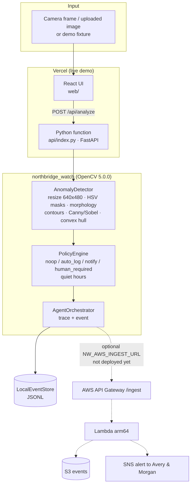

# Northbridge Watch

**OpenCV AI Competition 2026 (powered by AWS) · Agentic Vision path**

> A quiet home camera agent for the fictional **Northbridge** household (**Avery & Morgan**). OpenCV 5 looks at porch and kitchen frames. A small, auditable policy then decides whether to do nothing, log quietly, notify someone, or ask a human. What the camera sees changes what happens next.

[](LICENSE)
[](https://opencv.org/)
[](https://github.com/dl88jing/northbridge-watch/actions/workflows/ci.yml)
[](docs/aws-deploy.md)

| | |
|---|---|
| **Live app** | **<https://northbridge-watch.vercel.app>**: real OpenCV 5 running in a Vercel Python function (`/api/health`, `/api/analyze`). Try the 5 demo scenes or upload your own image. |
| **Technical report** | [`docs/technical-report.md`](docs/technical-report.md) ([PDF](docs/technical-report.pdf)) |
| **Architecture** | [`docs/architecture.png`](docs/architecture.png) |
| **Pitch deck** | [`docs/pitch-deck.pdf`](docs/pitch-deck.pdf) |
| **Evaluation** | [`docs/eval/results.md`](docs/eval/results.md) · v1 baseline [`docs/eval/baseline-v1/results.md`](docs/eval/baseline-v1/results.md) · failures [`docs/failures/`](docs/failures/) |
| **Hackathon** | [opencv26.devpost.com](https://opencv26.devpost.com/) |

---

## One-command demo

```bash
git clone https://github.com/dl88jing/northbridge-watch.git && cd northbridge-watch
make demo     # creates .venv, regenerates fixtures, runs the OpenCV 5 → policy → action loop
make test     # 42 pytest tests (detector, policy, orchestrator, Lambda handler, API contracts, AWS-honesty, eval regression)
make eval     # held-out synthetic evaluation → docs/eval/
```

No AWS keys, GPU or webcam needed. CI ([`.github/workflows/ci.yml`](.github/workflows/ci.yml)) runs the full test suite and `./demo.sh demo` on Python 3.11/3.12 and builds the web UI on every push. `./demo.sh` does the same thing as `make demo` on machines without `make`. To run locally with the UI: `make serve` (API on :8787) and `make web`.

| Scene | Perception | Action |
|---|---|---|
| `calm_porch` | none | `noop` |
| `package_at_door` | package (0.82) | `notify` (daytime) / `auto_log` (quiet hours) |
| `busy_porch` | 3 packages | `human_required` |
| `floor_spill` | spill (0.68) | `human_required` |
| `empty_fridge` | empty_fridge (0.76) | `notify` / quiet `auto_log` |

---

## Architecture



- **Perception** ([`detector.py`](northbridge_watch/vision/detector.py)), all classical OpenCV 5.0.0:
  - `resize` to a fixed working frame
  - HSV `inRange` masks, `morphologyEx` open/close
  - `findContours`, `approxPolyDP` rectangularity, `convexHull` solidity (spill irregularity)
  - `Sobel` tile-grid and shelf evidence on a `normalize`d image, `Canny` edge density
  - fridge occupancy gate, annotated overlays
- **Policy** ([`policy.py`](northbridge_watch/agent/policy.py)): deterministic rules for severity, quiet hours, multi-package escalation and the spill safety rule.
- **Orchestrator** ([`orchestrator.py`](northbridge_watch/agent/orchestrator.py)): writes a trace (perception → decision → actions) and persists the event.
- **Live API** ([`api/index.py`](api/index.py) → [`server.py`](northbridge_watch/api/server.py)): the same FastAPI app runs locally and as a Vercel Python function. Uploads are processed in memory and never written to disk.

## Measured results (held-out synthetic test split)

| Condition | v1 label acc | **v2 label acc** | Spill recall | Empty-fridge P/R | p50 ms |
|---|---|---|---|---|---|
| clean | 0.829 | **0.968** | 0.875 | 1.000 / 0.950 | 2.46 |
| photometric | 0.807 | **0.921** | 0.700 | 0.971 / 0.850 | 2.36 |
| half resolution | 0.446 | **0.968** | 0.875 | 1.000 / 0.950 | 2.77 |
| out-of-domain (coffee spill, white mailer, night) | — | **0.333** | 0.000 | n/a | 2.49 |

n = 280 in-domain images per condition (7 families × 40) and 120 OOD images, on test seeds that were never used for tuning. **These are synthetic scenes from our own generator, not real photos.** See the [report](docs/technical-report.md) for the protocol, failure cases and limitations.

## AWS status (honest)

The SAM stack ([`aws/template.yaml`](aws/template.yaml)) is written and the Lambda handler is unit-tested:

- API Gateway `POST /ingest` + `GET /health`
- Lambda (python3.12, arm64)
- encrypted private S3 event store
- SNS alerts for `notify`/`human_required`

**It is not deployed yet.** Once AWS credentials are available, `make deploy-aws` deploys the stack and sets `NW_AWS_INGEST_URL` as a Vercel env var. The live app then forwards every non-noop decision to S3/SNS and shows the S3 reference. Until then the live UI is an OpenCV 5 viewer with the AWS step labelled "AWS: deploy-ready, not deployed", and decisions are only kept in the function's temporary local log. Details: [`docs/aws-deploy.md`](docs/aws-deploy.md).

## Repository layout

```
northbridge_watch/   vision (OpenCV 5), agent (policy, orchestrator), aws (Lambda), api (FastAPI), eval
api/index.py         Vercel Python function entry
aws/                 SAM template
web/                 React UI (Vite)
docs/                report, architecture, eval results, failure gallery, deck
scripts/             fixtures, CLI demo, v1 baseline, failure gallery, AWS deploy
tests/               pytest suite
```

## Responsible use

- Demo scenes are synthetic, and the household is fictional.
- No people or faces are detected or identified.
- Spills and ambiguous cases always escalate to a human.
- This is **not** a safety or security device.
- For any real deployment: get consent, keep retention to a minimum, and prefer on-device processing.

## License

Apache-2.0, see [LICENSE](LICENSE). Team **Northbridge** · Household **Avery & Morgan**.
