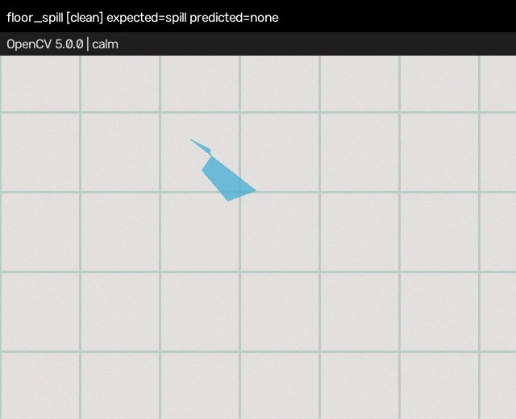
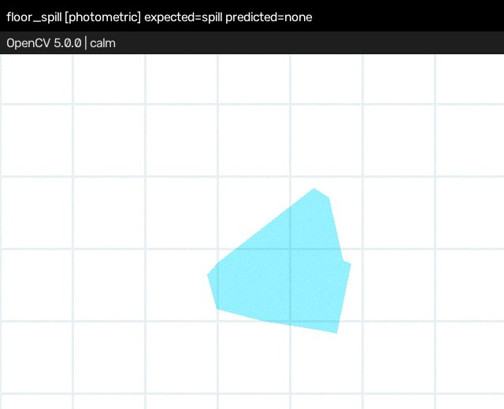
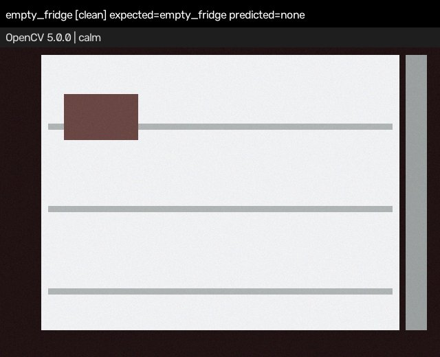
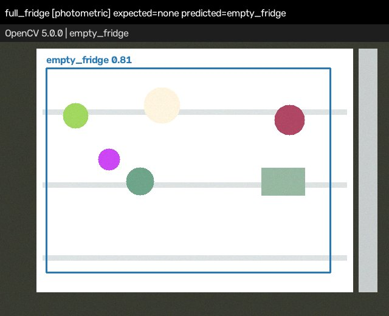
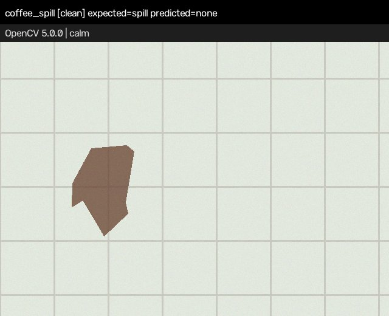
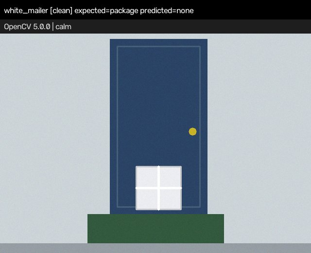

# Northbridge Watch — Technical Report

**OpenCV AI Competition 2026 · Agentic Vision path · Team Northbridge (Avery & Morgan)**
Live app: <https://northbridge-watch.vercel.app> · Code: <https://github.com/dl88jing/northbridge-watch> · Report date: 2026-10-25

> **What's real here.** Every number below was measured by running the code in this repo (`make eval`, `make baseline`). The evaluation uses **synthetic** images we generate ourselves. We have **not** tested on real camera photos. The AWS stack is written and tested locally but is **not deployed** yet (see §6). Please read the results with that in mind.

---

## 1. Problem and users

Home cameras send too many alerts. A typical motion-alert camera pings on every change, and people learn to ignore it. That includes the alerts that matter, like a spill someone could slip on or a pile of packages blocking the door.

**Users:** a small household. Our fictional one is the **Northbridge** household, **Avery & Morgan**. They want a camera that stays **quiet by default**. It should only interrupt them when what it sees changes what they ought to do next.

**Goal:** run OpenCV 5 perception on porch and kitchen frames and pass the result to a small, auditable policy agent. The agent picks one of four actions:

| Action | When | Interrupts a human? |
|---|---|---|
| `noop` | calm scene | no |
| `auto_log` | low-confidence or quiet-hours signal | no (logged only) |
| `notify` | single package (daytime, conf ≥ threshold), empty fridge | yes, one person |
| `human_required` | spill (safety), ≥ 2 packages (doorway blocked) | yes, both, needs ack |

## 2. Method (OpenCV 5 implementation)

All perception is classical OpenCV 5.0.0 (`opencv-python-headless==5.0.0.93`) in `northbridge_watch/vision/detector.py`. It uses no learned model and no external captioning API. Each frame goes through these steps:

1. **Resolution normalisation:** `cv2.resize` to a 640×480 working frame (INTER_AREA when downscaling). Added in v2 after evaluation showed that hard-coded pixel ROIs broke at half resolution (see §4).
2. **Scene context:**
   - Grayscale border/centre statistics.
   - Dark-door ROI and green doormat (HSV) → `porch_like`.
   - Tile-grid evidence → `floor_like`. This is the fraction of strong `cv2.Sobel` x/y gradients on a `cv2.normalize` min-max-stretched image, so it does not depend on exposure.
   - Dark surround with a bright interior → `fridge_like`.
3. **Package detector** (porch only, lower 55% of frame):
   - HSV cardboard mask (`cv2.inRange`) → `MORPH_CLOSE`/`MORPH_OPEN`.
   - `cv2.findContours` → area/aspect gates → `cv2.approxPolyDP` rectangularity.
   - Overlap-based merging, so tape lines do not split one box into two.
   - The count of boxes feeds the policy.
4. **Spill detector** (floor only):
   - HSV blue/teal liquid mask → elliptical morphology → contours.
   - **Irregularity** = 1 − solidity, using `cv2.convexHull`. Spills are blobby; tiles and boxes are not.
5. **Empty-fridge detector** (fridge only):
   - Interior brightness, shelf evidence (`cv2.Sobel`), and edge density (`cv2.Canny`).
   - v2 adds an **occupancy gate**: the share of interior pixels that are saturated or dark after a 5×5 open. Above 4% means "not empty".
6. **Annotation:** boxes, labels and a status bar (`cv2.rectangle`/`putText`), returned to the UI as a JPEG.

The **PolicyEngine** (`northbridge_watch/agent/policy.py`) is deterministic and readable. It sets severity, chooses notify targets, applies quiet hours (22:00–07:00 UTC by default) and decides whether an acknowledgement is needed. The **AgentOrchestrator** writes a trace with perception, decision and actions, and stores an event. Locally that goes to a JSONL file; in the cloud design it goes to Lambda → S3 + SNS.

## 3. Architecture


(Source: [`architecture.mmd`](architecture.mmd).) Live path: React UI → `POST /api/analyze` → Vercel Python function (`api/index.py`, the same FastAPI app as local) → OpenCV 5 detector → policy → trace + annotated frame. If the `NW_AWS_INGEST_URL` environment variable is set, the server also forwards every non-`noop` decision to the AWS ingest API. The dashed edges are designed but not deployed.

## 4. Evaluation

### 4.1 Protocol

We have no labelled real-world dataset, so we built a **reproducible synthetic benchmark** (`northbridge_watch/eval/`):

- **7 in-domain families**, each randomised (geometry, colours, counts, positions, sensor noise): calm porch, single package, busy porch (2–4 packages), floor spill, clean floor, empty fridge (0–1 items), full fridge (5–9 items).
- **5 conditions:** clean; photometric (random gain/bias/gamma); blur + Gaussian noise; JPEG quality 30; half resolution (320×240).
- **3 out-of-domain (OOD) families** that we deliberately did **not** tune for: brown coffee spill, white mailer package, and a package at night (35% brightness).
- **Splits:** we tuned v2 thresholds only on the **dev seeds** (seed0 = 1000). All numbers below are on **held-out test seeds** (seed0 = 50000). n = 40 per family per condition (280 in-domain images per condition, 120 OOD).
- **Metrics:** label accuracy, action accuracy (policy at a fixed daytime clock), per-class precision/recall, exact package count on busy porches, and per-frame latency (detector + policy).
- **Hardware:** the shared Linux x86_64 dev box (8 vCPU), Python 3.13.5, OpenCV 5.0.0.

Reproduce with `make eval` (v2) and `make baseline` (v1 detector from commit `2fe7893`, run on the same test split). Raw per-image rows are in [`eval/rows.csv`](eval/rows.csv).

### 4.2 Results: v2 (current) vs v1 (as originally submitted)

| Condition | v1 label acc | **v2 label acc** | v2 action acc | v2 Package P/R | v2 Spill P/R | v2 Empty-fridge P/R | v2 busy count exact | v2 p50 / p95 ms |
|---|---|---|---|---|---|---|---|---|
| clean | 0.829 | **0.968** | 0.964 | 1.000 / 0.975 | 1.000 / 0.875 | 1.000 / 0.950 | 0.925 | 2.46 / 3.57 |
| photometric | 0.807 | **0.921** | 0.914 | 1.000 / 0.963 | 1.000 / 0.700 | 0.971 / 0.850 | 0.850 | 2.36 / 3.35 |
| blur_noise | 0.839 | **0.975** | 0.975 | 1.000 / 1.000 | 1.000 / 0.875 | 1.000 / 0.950 | 1.000 | 2.05 / 3.04 |
| jpeg_q30 | 0.832 | **0.968** | 0.964 | 1.000 / 0.975 | 1.000 / 0.875 | 1.000 / 0.950 | 0.900 | 2.49 / 3.65 |
| half_res | 0.446 | **0.968** | 0.964 | 1.000 / 0.975 | 1.000 / 0.875 | 1.000 / 0.950 | 0.925 | 2.77 / 3.90 |
| OOD (clean) | — | **0.333** | 0.333 | 1.000 / 0.500 | n/a / 0.000 | n/a | n/a | 2.49 / 3.69 |

Full tables: [`eval/results.md`](eval/results.md) (v2) and [`eval/baseline-v1/results.md`](eval/baseline-v1/results.md) (v1). For reference, v2 on the dev split scores 0.993 (clean), 0.954 (photometric) and 0.993 (half_res). The gap between dev and test is the overfitting you would expect from tuning thresholds on the dev seeds.

**Canonical demo fixtures** (the 5 images in the live app): all 5 are labelled correctly and get the expected action. p50 latency is 1.3–2.7 ms per frame.

**Live deployment latency** (measured 2026-10-25 against the production URL, 15 warm requests, `floor_spill`): server-side `pipeline_ms` ≈ 10 ms (9.8–13.7), client round trip 67–124 ms. The first cold request reported 89 ms server-side.

### 4.3 What the evaluation changed

Running the benchmark against v1 showed three real bugs, which we fixed in v2:

1. **Every full fridge was labelled "empty"** (v1 empty-fridge precision 0.50; full_fridge 0/40 correct). Fix: the occupancy gate.
2. **Half resolution broke package detection completely** (v1 package recall 0.000 and spill recall 0.125 at 320×240). The cause was ROIs and area thresholds hard-coded in pixels. Fix: resize to a fixed working frame.
3. **Spill recall dropped under exposure changes** (v1: 0.55 photometric). Fix: grid evidence on a min-max-stretched image and relative brightness tests. This raised it to 0.70; it is still the weakest in-domain number.

We also found that the fixtures were not reproducible: they were seeded with Python's salted `hash()`. They now use `zlib.crc32`.

## 5. Failure cases

Rendered from real misses in the test split (`make failures` → [`failures/`](failures/)):

| Image | What happened | Why |
|---|---|---|
|  | Small spill, predicted `none` | Blob area under `min_spill_area` = 5000 px². 5/40 clean spills missed for this reason. |
|  | Spill missed under exposure shift | The HSV saturation/value bounds of the liquid mask fall outside its range under strong gain or gamma (12/40 missed). |
|  | "Empty" fridge with one large item → `none` | The single item covers more than 4% of the interior, so the occupancy gate says "not empty". Our label definition (0–1 items = empty) is itself debatable. |
|  | Full fridge → `empty_fridge` (1/40, photometric) | Washed-out item colours fall below the saturation threshold. |
|  | Brown coffee spill → `none` (0/40) | The spill mask is hue-specific (blue/teal). Brown liquids are out of range. |
|  | White mailer → `none` (0/40) | The package mask is cardboard-hue-specific. |

The night-time package OOD family was detected 40/40.

## 6. AWS deployment

**Designed and tested locally. Not deployed as of 2026-10-25.**

- `aws/template.yaml` (SAM): API Gateway (`POST /ingest`, `GET /health`) → Lambda (python3.12, **arm64/Graviton**, 512 MB) → S3 (encrypted, public access blocked) for event JSON, plus SNS for `notify`/`human_required` alerts. IAM uses least-privilege SAM policy templates (`S3CrudPolicy`, `SNSPublishMessagePolicy`).
- The Lambda handler (`northbridge_watch/aws/handler.py`) is covered by unit tests: a health route, ingest with a provided decision, and a clear error when the decision is missing in the slim bundle.
- The Vercel API already contains the forwarding client. Setting `NW_AWS_INGEST_URL` as a Vercel project environment variable (never committed) turns it on, and the UI then shows the S3 reference for each event.
- One command, once credentials exist: `make deploy-aws`. This runs `sam build && sam deploy`, curls `/health`, stores the URL as a Vercel env var and redeploys.

**Why not deployed:** this build environment has no AWS account credentials. We chose not to claim a deployment we cannot show. The live app labels this honestly ("AWS ingest: not deployed yet").

## 7. Limitations

- **Synthetic-only evaluation.** The generator and the detector were written by the same team, so the in-domain numbers are optimistic. They show robustness to the perturbations we modelled, not real-world accuracy. We have no evaluation on real porch or kitchen photos.
- **Colour-specific heuristics.** Packages are found by a cardboard hue and spills by a blue/teal hue. The OOD results (coffee 0%, white mailer 0%) show these fail outside those colours.
- **Fixed scene layout.** The context ROIs (door, doormat, fridge interior) assume a framing like our fixtures. A different camera angle will degrade results, and we have not measured by how much.
- **No temporal reasoning.** Each frame is judged on its own: no tracking, no debouncing, and no "package removed" event.
- **Latency** numbers are from a shared dev box and Vercel serverless, not from an edge device or Lambda.
- **Policy** thresholds are hand-set. Quiet hours are in UTC, not the household's time zone.

## 8. Responsible use

- **Privacy by design:** frames are processed in memory. The live API does not store uploaded images; only structured perception and decision JSON is logged (to `/tmp` on Vercel, or encrypted private S3 when AWS is enabled). No faces or people are detected or identified, and the system does not attempt to.
- **Human in the loop:** safety-relevant events (spills) and ambiguous ones (multiple packages) always escalate with `human_required` and pause automation until someone acknowledges. The agent never takes physical or irreversible actions.
- **Not a safety device:** a missed spill is possible (spill recall 0.70–0.875 on our synthetic data). Do not rely on this for fall prevention or security.
- **Consent:** only point cameras at spaces you control, and tell other household members and visitors.
- **Pseudonymous demo:** the household and team names are fictional (Northbridge, Avery & Morgan).

## 9. Reproduce

```bash
git clone https://github.com/dl88jing/northbridge-watch && cd northbridge-watch
make demo       # OpenCV 5 agent loop on 5 fixtures
make test       # 42 pytest tests (also run by GitHub Actions CI on every push)
make eval       # held-out evaluation -> docs/eval/
make baseline   # v1 comparison -> docs/eval/baseline-v1/
make failures   # failure gallery -> docs/failures/
```
